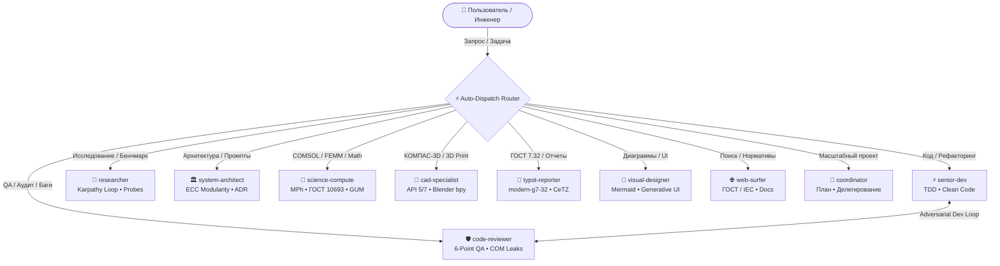

# ⚡ Antigravity Multi-Agent Ecosystem (v2.5)
### Высокопроизводительный инженерный сквад и токен-экономика «Think in Code»

[-FF6D00?style=flat-square)](https://github.com)

*Глобальный инженерный плагин для Google Antigravity: проектирование в САПР (КОМПАС-3D, Blender), физико-математическое моделирование (COMSOL Multiphysics MPh, FEMM, GUM), разработка по стандартам TDD, автономные эмпирические исследования (Karpathy Autoresearch), системная модульная архитектура (ECC) и публикационные отчеты по ГОСТ 7.32.*

[Быстрый старт](#-быстрый-старт-за-3-шага) • [Авто-выбор агентов](#-автоматический-выбор-агентов-auto-dispatch) • [Команда субагентов](#-команда-субагентов-10-ролей) • [Матрица скилов](#-матрица-14-прогрессивных-скилов) • [Токен-экономика](#-токен-экономика-think-in-code)

---

> [!IMPORTANT]
> ### 📦 Получили архив `antigravity-team-portable.zip`? Установка в 1 клик для друга:
> 1. **Распакуйте архив** в любую удобную папку (нажмите правой кнопкой мыши $\to$ **«Извлечь всё...»**).
> 2. **Запустите установку**: внутри распакованной папки нажмите правой кнопкой на **`install-team.ps1`** $\to$ выберите **«Выполнить с помощью PowerShell»** *(или выполните в терминале `powershell -ExecutionPolicy Bypass -File .\install-team.ps1`)*.
> 3. **Скрипт сделает всё сам**:
>    - Скопирует команду из 10 агентов и 14 скилов в системный каталог Antigravity (`~/.gemini/config/plugins/antigravity-team`).
>    - Активирует плагин в `config.json`.
>    - Включит Auto-Dispatch правила (агенты выбираются сами).
>    - Предложит доустановить нужные библиотеки (`MPh` для COMSOL, `pytest`, `pint`, `uncertainties`, `numpy`, `scipy`).
> 4. **Перезапустите Antigravity** — готово! Все субагенты и навыки доступны во всех ваших проектах.

---

## 🚨 Автоматический выбор агентов (Auto-Dispatch)

Вам больше не требуется вручную звать агентов по именам. Согласно правилам `rules/AGENTS.md`, Antigravity автоматически определяет предметную область запроса и вызывает профильного специалиста через `invoke_subagent`:

| Обнаруженная задача | Профильный агент | Выполняемое действие |
| :--- | :--- | :--- |
| **Код, баги, рефакторинг, тесты** | ⚡ `senior-dev` | Написание чистого кода по циклу TDD без лишних типов. |
| **Аудит безопасности, поиск утечек памяти** | 🛡️ `code-reviewer` | Противнический 6-точечный QA-контроль. |
| **Исследования библиотек, бенчмарки** | 🔬 `researcher` | Цикл Karpathy & Hermes: гипотеза $\to$ скрипт $\to$ факты. |
| **Архитектура модулей, промпты, интерфейсы** | 🏛️ `system-architect` | Стандарт ECC (Everything Claude Code), ADR-записи. |
| **COMSOL, MPh, высоковольтные вводы, FEMM, погрешности** | 🧮 `science-compute` | Физико-математическое моделирование и метрология. |
| **КОМПАС-3D, Blender bpy, 3D-печать (FDM/SLA)** | 📐 `cad-specialist` | Автоматизация САПР pywin32 API 5/7, допуски. |
| **Отчеты по ГОСТ 7.32, Typst, схемы CeTZ** | 📄 `typst-reporter` | Публикационные документы по ГОСТ/ЕСКД. |
| **Диаграммы Mermaid, UI-виджеты, дашборды** | 🎨 `visual-designer` | Интерактивные интерфейсы и визуализация. |
| **Поиск в интернете, стандарты ГОСТ/IEC** | 🌐 `web-surfer` | Точечный сбор фактов без информационного шума. |
| **Комплексные междисциплинарные проекты** | 🎯 `coordinator` | Декомпозиция, Roadmaps, оркестровка. |

---

## 🧭 Архитектура экосистемы

---

## 👥 Команда субагентов (10 ролей)

1. 🎯 **`coordinator`** — Центральный оркестратор.
2. ⚡ **`senior-dev`** — Ведущий разработчик (TDD, чистый код без бюрократии типов).
3. 🛡️ **`code-reviewer`** — QA-аудитор (проверка на утечки ресурсов, краевые случаи, безопасность).
4. 🔬 **`researcher`** — Автоисследователь в стиле Andrej Karpathy и NousResearch Hermes.
5. 🏛️ **`system-architect`** — Системный архитектор в стиле ECC (Everything Claude Code).
6. 🧮 **`science-compute`** — Физик-вычислитель (COMSOL MPh, FEMM, расчет вводов, погрешности ГОСТ 8.207).
7. 📐 **`cad-specialist`** — САПР-инженер (КОМПАС-3D API 5/7, Blender bpy, 3D-печать).
8. 📄 **`typst-reporter`** — Технический писатель (ГОСТ 7.32, Typst, CeTZ).
9. 🎨 **`visual-designer`** — Дизайнер визуализации (Mermaid, Generative UI).
10. 🌐 **`web-surfer`** — Веб-исследователь (поиск стандартов ГОСТ/IEC, документация).

---

## 🛠️ Матрица 14 навыков (Skills)

1. `autoresearch` — Автономный цикл Karpathy (гипотеза $\to$ скрипт $\to$ метрика $\to$ выжимка).
2. `system-architecture` — Стандарты модульной архитектуры и ADR по стилю ECC.
3. `token-budget-optimizer` — Оптимизация контекста и защита от выгорания токенов.
4. `test-driven-development` — Рабочий процесс TDD для Python, JavaScript, Rust, C++.
5. `systematic-debugging` — Научная отладка по гипотезам (правило Halt-at-2).
6. `code-refactoring-and-architecture` — Принципы Clean Code и устранение мертвого кода.
7. `git-workflow-and-commits` — Conventional Commits 1.0 и атомарные коммиты.
8. `hv-bushing-calc` — Расчет высоковольтных вводов в COMSOL Multiphysics и FEMM.
9. `metrology-lab-data` — Статистическая обработка измерений по ГОСТ 8.207.
10. `uncertainty-and-units` — Учет размерностей и погрешностей по GUM (`pint`, `uncertainties`).
11. `kompas-3d-automation` — Управление КОМПАС-3D через pywin32 API 5/7.
12. `blender-bpy-modeling` — Headless Python-скриптинг Blender (`bpy`).
13. `three-d-printing-preflight` — Инженерный контроль 3D-печати (допуски, усадка).
14. `typst-report` — Компиляция отчетов по ГОСТ 7.32 с векторной графикой CeTZ.
