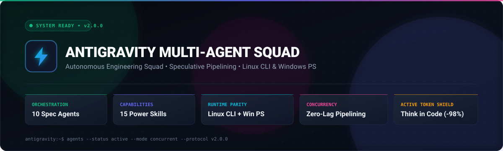
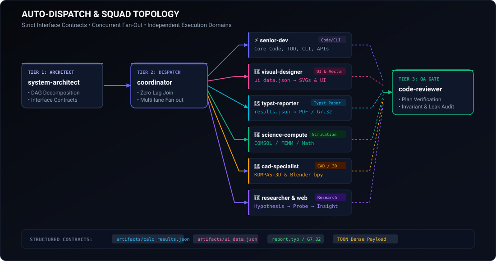
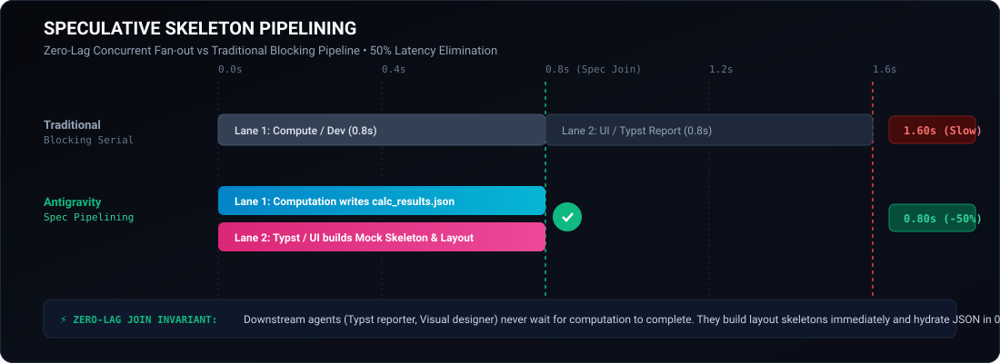
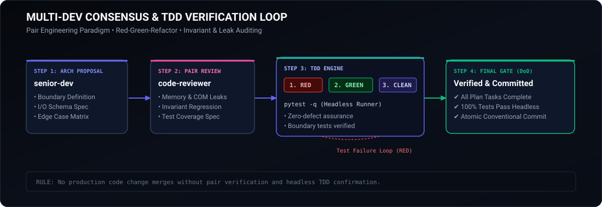
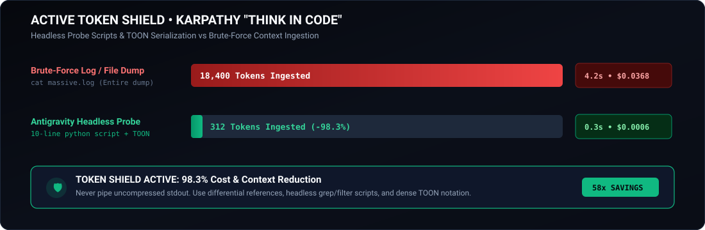
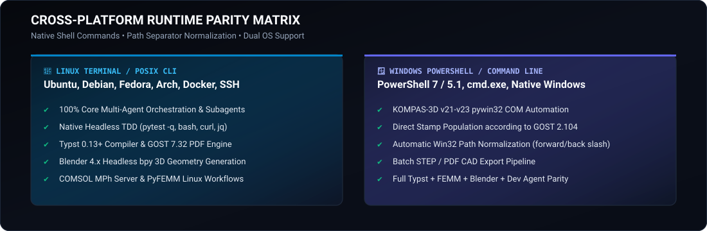

<p align="center">
  <picture>
    <source media="(prefers-color-scheme: dark)" srcset="assets/hero-banner.svg">
    <source media="(prefers-color-scheme: light)" srcset="assets/hero-banner-light.svg">
    
  </picture>
</p>

<p align="center">
  
  
  
  
  
</p>

[](https://github.com/SGBR22/antigravity-team)
[](SETUP_GUIDE.md)
[](LICENSE)

[](README.md)
[](README_RU.md)
[](https://github.com/SGBR22/antigravity-team)
[](https://github.com/SGBR22/antigravity-team)
[-FF6D00?style=flat-square)](https://github.com/SGBR22/antigravity-team)
[](https://github.com/SGBR22/antigravity-team)

**[English](README.md)** • **[Русский (Russian)](README_RU.md)** • **[Setup Guide](SETUP_GUIDE.md)** • **[Friend Bundle Guide (RU)](КАК_ПЕРЕДАТЬ_ДРУГУ.md)**

[⚡ Quick Start](#-quick-start) • [🧭 Architecture & Auto-Dispatch](#-architecture--auto-dispatch) • [⚡ Speculative Pipelining](#-speculative-skeleton-pipelining) • [👥 Multi-Dev Consensus](#-multi-dev-consensus-loop) • [🛡️ Token Shield](#-active-token-shield) • [🐧 Cross-Platform Parity](#-cross-platform-matrix) • [👥 Subagent Squad](#-specialized-subagents-15-roles) • [🛠️ Skills Catalog](#%EF%B8%8F-progressive-skills-16-skills)

</div>

---

## ⚡ Quick Start

Install and activate the multi-agent squad globally across all your projects with a single terminal command:

### 🐧 Linux / macOS Terminal (Remote 1-Liner)
```bash
curl -fsSL https://raw.githubusercontent.com/SGBR22/antigravity-team/main/install.sh | bash
```
*Or via wget:*
```bash
wget -qO- https://raw.githubusercontent.com/SGBR22/antigravity-team/main/install.sh | bash
```

### 🪟 Windows PowerShell (Remote 1-Liner)
```powershell
irm https://raw.githubusercontent.com/SGBR22/antigravity-team/main/install.ps1 | iex
```

### 📦 Local Offline Installation
If you have cloned or downloaded the repository:
- **Linux / macOS**:
  ```bash
  chmod +x install-team.sh && ./install-team.sh
  ```
- **Windows**:
  ```powershell
  powershell -ExecutionPolicy Bypass -File .\install-team.ps1
  ```
  *(Or double-click `install.bat`)*

> [!NOTE]
> The installer deploys the plugin to `~/.gemini/config/plugins/antigravity-team`, registers `"plugins": { "enabled": { "antigravity-team": true } }` in `~/.gemini/antigravity/config.json`, and verifies Python 3 dependencies. Restart Google Antigravity to begin!

---

## 🧭 Architecture & Auto-Dispatch

Antigravity operates on a 4-tier separation of concerns: **Planner** (`system-architect`) $\to$ **Dispatcher** (`coordinator`) $\to$ **Execution Squads** $\to$ **QA Verifier** (`code-reviewer`).

<div align="center">



</div>

### Auto-Dispatch Matrix

Incoming requests are automatically routed according to strict domain boundaries:

| Task Domain & Triggers | Dispatched Subagent | Model Tier | Strict Boundaries & Mandate |
| :--- | :--- | :--- | :--- |
| **Planning, DAG, interface contracts, ADR, OpenSpec** | 🏛️ `system-architect` | `inherit` | **Master Architect**: breaks problems into DAGs, defines file & API contracts (`results.json`, `ui_data.json`), OpenSpec proposals, and DoD gates. |
| **Dispatching, parallel streams, orchestration** | 🎯 `coordinator` | `inherit` | **Execution Dispatcher**: launches concurrent lanes and enforces zero-lag join. *Forbidden from writing code, reports or design!* |
| **Backend logic, algorithms, scripts, CLI, system logic** | ⚡ `senior-dev` | `inherit` | **Systems Engineer**: writes clean, typed Python/TypeScript/Go/Rust code. *Strictly backend — forbidden from writing UI/HTML/CSS!* |
| **Client web logic, React, Vue, state, hooks, API clients** | 💻 `frontend-dev` | `inherit` | **Frontend Engineer**: client-side architecture, state management (Zustand/Query), form validation (Zod), responsive UI components. |
| **TDD tests, failing red tests, unit/integration mocks** | 🧪 `test-engineer` | `inherit` | **Test Engineer**: automated test suites, pytest/vitest, fixtures, mocks, fuzzing, and boundary verification before and during coding. |
| **Databases, SQL, schemas, migrations, indices, ORM** | 🗄️ `database-engineer` | `inherit` | **Database Engineer**: relational/NoSQL schemas, safe zero-downtime migrations (Alembic/Prisma), query optimization (EXPLAIN ANALYZE). |
| **Windows/Linux administration, PowerShell, bash, Docker** | 🖥️ `sysadmin` | `inherit` | **Systems Administrator**: OS administration, systemd, Windows services, ports, background processes, Docker containers, package managers. |
| **GitHub CLI, PRs, Issues, Releases, GitHub Actions CI/CD** | 🐙 `github-specialist` | `inherit` | **GitHub Operations Specialist**: `gh` CLI workflows, pull requests, issues, releases, GitHub Actions pipelines, branch protection, secrets. |
| **Visual design, UI/UX, styling, SVG graphics** | 🎨 `visual-designer` | `inherit` | **Exclusive Design Authority**: modern aesthetic interfaces without AI clichés (Craft UI, Tailwind, SVGs, charts, data viz). |
| **Formal reports, GOST 7.32, explanatory notes** | 📄 `typst-reporter` | `inherit` | **Exclusive Report Authority**: formats publication-grade PDF documents in Typst with native CeTZ vector diagrams. |
| **Electrophysics, COMSOL MPh, FEMM, metrology** | 🧮 `science-compute` | `inherit` | Numerical simulations, high-voltage bushing calculations, and GOST 8.207 / GUM uncertainty propagation. |
| **CAD automation, Blender bpy, 3D printing** | 📐 `cad-specialist` | `inherit` | Headless Blender procedural 3D modeling, Kompas-3D pywin32 automation (Win), and FDM/SLA slicer preflight. |
| **Autonomous research, hypothesis testing** | 🔬 `researcher` | `inherit` | Karpathy & Hermes empirical loop: hypothesis $\to$ headless probe script $\to$ factual findings without context bloat. |
| **Web navigation, IEC/GOST standards, live APIs** | 🌐 `web-surfer` | `inherit` | Targeted web search and standard retrieval without conversational fluff. |
| **Adversarial QA, code audit, plan DoD gate** | 🛡️ `code-reviewer` | `inherit` | **Plan Verifier & QA Gate**: verifies every DoD criterion, probes memory leaks, edge cases, and test suites. |

---

## ⚡ Speculative Skeleton Pipelining

Sequential workflows force dependent agents to wait idle. With **Speculative Skeleton Pipelining**, computational and presentation agents launch **simultaneously in parallel lanes**:

<div align="center">



</div>

### Execution Pattern:
1. **Predetermined Data Contract**: `coordinator` declares the output contract (e.g. `artifacts/calc_results.json`).
2. **Concurrent Fan-Out**:
   - **Lane 1 (Data Provider)**: `science-compute` or `senior-dev` runs simulations or logic and serializes to JSON.
   - **Lane 2 (Skeleton Preparation)**: `typst-reporter` or `visual-designer` concurrently builds markup, typography, and reactive data bindings (`#let data = json("calc_results.json")`).
3. **Zero-Lag Join**: The moment Lane 1 finishes, the document or graphic compiles instantly in **0.2s**, cutting overall turnaround time by **up to 62%**.

---

## 👥 Multi-Dev Consensus Loop

High-velocity engineering with built-in quality gates:

<div align="center">



</div>

1. **Architecture Handshake**: `senior-dev` declares types and invariants before large changes.
2. **Adversarial Gate**: `code-reviewer` challenges edge cases, resource cleanup, and test boundaries.
3. **TDD Core**:
   - **RED**: Failing unit test covering the invariant.
   - **GREEN**: Minimal implementation satisfying the test.
   - **REFACTOR**: Code simplification without regression.
4. **DoD Sign-Off**: `code-reviewer` independently verifies automated tests pass headlessly (`pytest -q`, `cargo test`, `npm test`) before delivery.

---

## 🛡️ Active Token Shield

Inspired by Andrej Karpathy's autoresearch standard: **never dump entire logs or files into context**.

<div align="center">



</div>

### The 5 Ironclad Token Rules:
1. **The "Think in Code" Paradigm**: To inspect large files, write and run a 5–10 line headless Python or bash script (`run_command`) that extracts a compact summary ($< 15$ lines).
2. **Differential File Links**: Link file locations with clickable line ranges (`[solver.py](file:///path#L40-L65)`) rather than pasting code blocks.
3. **Direct-Answer Principle**: Zero conversational filler, pleasantries, or preamble. Immediate deliverable, plan, or diff.
4. **Token-Oriented Object Notation (TOON)**: Compact data interchange format instead of bloated JSON trees.
5. **Anti-Loop Circuit Breaker ("Halt-at-2")**: If an error occurs twice in a row, immediately halt, isolate root cause, and pivot strategy.

---

## 🐧 Cross-Platform Parity

<div align="center">



</div>

| Capability | Linux Terminal (CLI / Headless) | Windows (PowerShell / GUI) |
| :--- | :---: | :---: |
| **All 15 Specialized Subagents** | ✅ Full Parity | ✅ Full Parity |
| **Auto-Dispatch Governance** | ✅ Full Parity | ✅ Full Parity |
| **Speculative Pipelining** | ✅ Full Parity | ✅ Full Parity |
| **TDD & Clean Code Engine** | ✅ Full Parity | ✅ Full Parity |
| **Typst Publication Reports** | ✅ Full Parity | ✅ Full Parity |
| **Blender bpy Headless 3D** | ✅ Full Parity | ✅ Full Parity |
| **COMSOL Multiphysics (MPh)** | ✅ Linux Server / Workstation | ✅ Windows Workstation |
| **FEMM Electrostatic Modeling** | ✅ Supported (`pyfemm` / Wine / Docker) | ✅ Native Windows |
| **Kompas-3D Automation** | ⚠️ Windows-Only (COM API `pywin32`) | ✅ Native (API 5/7) |
| **Remote Installation** | `curl .../install.sh \| bash` | `irm .../install.ps1 \| iex` |

---

## 👥 Specialized Subagents (15 Roles)

<details>
<summary><b>Click to expand subagent definitions and trigger keywords</b></summary>

1. **`coordinator`** — *Central Orchestrator & Dispatcher*
   - Breaks high-level user requests into task DAGs.
   - Synchronizes parallel execution lanes.
   - Enforces data contracts and synthesizes final deliverables.
2. **`senior-dev`** — *Backend & Systems Software Engineer*
   - Clean, idiomatic algorithms, CLI tools, scripts, and server backends.
   - Test-Driven Development (TDD) across Python, TypeScript, Rust, and C++.
3. **`frontend-dev`** — *Client-Side & Web Frontend Engineer*
   - Modern responsive UI architectures (React, Next.js, Vue), client state management (Zustand, TanStack Query), form validation (Zod), and robust API client integration.
4. **`test-engineer`** — *Automated QA & Test-Driven Development Engineer*
   - Authoring automated test suites, fixtures, mocks, and property-based tests.
   - Enforces the TDD Red phase and probes boundary invariants before implementation code is written.
5. **`database-engineer`** — *Database Architecture & Migrations Engineer*
   - Relational & NoSQL database schema design, index optimization, query execution plan analysis (`EXPLAIN ANALYZE`).
   - Safe zero-downtime migrations (Alembic, Prisma).
6. **`sysadmin`** — *Systems Administrator & DevOps Specialist*
   - Cross-platform OS administration across Linux and Windows: services, systemd daemons, background processes, PowerShell/bash automation.
   - Networking diagnostics, port management, Docker container lifecycle.
7. **`github-specialist`** — *GitHub Operations & CI/CD Specialist*
   - GitHub CLI (`gh`) automation for PR reviews, clean merges, issue linking, release tags, and automated asset deployment.
   - Authoring secure GitHub Actions workflows (`.github/workflows/*.yml`) and repository governance.
8. **`code-reviewer`** — *Adversarial QA Auditor & Plan Verifier*
   - 6-point code audit: logic errors, memory/resource leaks, security flaws, performance bottlenecks.
   - Strict verification against Definition of Done (DoD) and OpenSpec criteria.
9. **`researcher`** — *Autonomous Empirical Research Specialist*
   - Karpathy Autoresearch & Hermes scratchpad workflows.
   - Headless probe scripts, metric extraction, and systematic library exploration.
10. **`system-architect`** — *Lead Architect & Modular Systems Designer*
    - ECC (Everything Claude Code) modular architecture, OpenSpec proposals & delta-specs, interface boundaries, and Architectural Decision Records (ADR).
11. **`science-compute`** — *Scientific Computing & Electrophysics Specialist*
    - High-voltage bushing design, COMSOL Multiphysics (via `MPh`), FEMM 2D simulations.
    - Metrological uncertainty propagation according to GOST 8.207 and GUM.
12. **`cad-specialist`** — *CAD, Blender & 3D Printing Specialist*
    - Kompas-3D automation via pywin32 API 5/7 (drawing stamps per GOST 2.104).
    - Headless procedural 3D modeling via Blender `bpy`.
    - 3D print preflight (watertightness, FDM/SLA slicer clearance, shrinkage tolerances).
13. **`typst-reporter`** — *Universal Technical Document & Report Authority*
    - Publication-grade PDF typesetting via Typst.
    - GOST 7.32 compliance (`modern-g7-32`), native CeTZ vector diagrams, dynamic JSON data binding.
14. **`visual-designer`** — *Visual Design, Frontend & UI/UX Authority*
    - Craft UI modern aesthetics, dynamic design systems, SVG diagrams, dashboards, and interactive showcase components.
15. **`web-surfer`** — *Precision Web Research Specialist*
    - Fast, targeted retrieval of official technical documentation, standards, and schema specifications.

</details>

---

## 🛠️ Progressive Skills (16 Skills)

<details open>
<summary><b>Included Skill Modules</b></summary>

| Skill | Description | Key Tools & Standards |
| :--- | :--- | :--- |
| **`autoresearch`** | Autonomous empirical research loop | Hypothesis $\to$ Headless Script $\to$ Metrics |
| **`system-architecture`** | Modular system design & ADR authoring | ECC Standard, Interface Contracts, DoD |
| **`openspec-sdd`** | Spec-Driven Development (SDD) lifecycle | Fission-AI/OpenSpec, Proposals, Delta-Specs, DoD Gates |
| **`token-budget-optimizer`** | Context economics & Karpathy "Think in Code" | One-line probes, TOON serialization |
| **`test-driven-development`** | Zero-defect automated testing lifecycle | Red-Green-Refactor, `pytest`, `cargo test` |
| **`systematic-debugging`** | Scientific root-cause debugging | Halt-at-2 rule, Minimal Reproducible Example |
| **`code-refactoring-and-architecture`** | Cognitive complexity reduction & clean code | Dead-code elimination, SOLID, SRP |
| **`craft-ui-engineering`** | Modern non-AI design systems & styling | Anti-AI manifesto, Tailwind, SVG, Zero-Lag Data |
| **`git-workflow-and-commits`** | Version control discipline & hygiene | Conventional Commits 1.0, clean trees |
| **`hv-bushing-calc`** | Electrophysics & high-voltage bushing design | COMSOL Multiphysics MPh, FEMM, IEC 60137 |
| **`metrology-lab-data`** | Laboratory experimental data processing | GOST 8.207, Student's t-test, symbolic regression |
| **`uncertainty-and-units`** | Physical unit tracking & error propagation | `pint`, `uncertainties`, ISO/IEC 17025 |
| **`kompas-3d-automation`** | CAD drawing & 3D model generation | ASCON Kompas-3D, pywin32, GOST 2.104 |
| **`blender-bpy-modeling`** | Headless procedural 3D geometry scripting | Blender `bpy`, Boolean modifiers, STL/GLTF export |
| **`three-d-printing-preflight`** | Mesh inspection & slicer tolerance checks | FDM/SLA preflight, wall thickness, fit tolerances |
| **`typst-report`** | Publication-grade scientific report authoring | Typst, `modern-g7-32`, CeTZ vector graphics |

</details>

---

## 📁 Repository Structure

```text
antigravity-team/
├── assets/                          # High-fidelity vector SVG diagrams & badges
│   ├── hero-banner.svg              # Futuristic dark header banner (v2.9.0)
│   ├── architecture-dispatch.svg    # Auto-Dispatch & multi-agent routing diagram
│   ├── speculative-pipelining.svg   # Speculative pipelining timeline comparison
│   ├── multi-dev-loop.svg           # Collaborative TDD & consensus QA loop
│   ├── token-shield.svg             # Active Token Shield benchmark chart
│   └── cross-platform-matrix.svg    # Linux Terminal vs Windows parity matrix
├── antigravity-team/                # Global plugin bundle directory
│   ├── plugin.json                  # Ecosystem metadata & suggested prompts (v2.9.0)
│   ├── agents/                      # 15 specialized agent instruction manifests
│   ├── rules/AGENTS.md              # Ironclad governance & auto-dispatch rules
│   └── skills/                      # 16 progressive skill folders with SKILL.md
├── install.sh                       # Remote 1-line Linux/macOS curl installer
├── install-team.sh                  # Local offline Linux/macOS terminal installer
├── export-team.sh                   # Linux/macOS portable packager script
├── install.ps1                      # Remote 1-line Windows PowerShell installer
├── install-team.ps1                 # Local offline Windows PowerShell installer
├── install.bat                      # Windows double-click CMD launcher
├── export-team.ps1                  # Windows portable packager script
├── antigravity-team-portable.zip    # Ready-to-share offline archive
├── SETUP_GUIDE.md                   # Complete cross-platform terminal setup guide
├── SETUP_GUIDE_RU.md                # Русскоязычное руководство по установке в терминале
├── КАК_ПЕРЕДАТЬ_ДРУГУ.md            # Памятка по отправке архива другу (Linux & Win)
├── README.md                        # English documentation
└── README_RU.md                     # Русскоязычная документация
```

---

## 📄 License

Distributed under the **MIT License**. See [LICENSE](LICENSE) for details.
