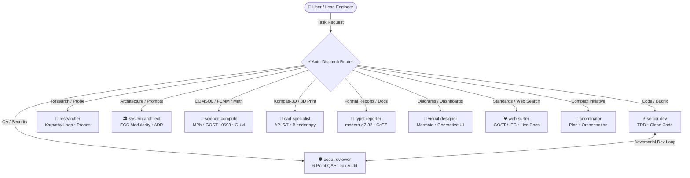

# ⚡ Antigravity Multi-Agent Ecosystem (v2.5)
### High-Velocity Engineering Squad & "Think in Code" Token Economy for Google Antigravity

<div align="center">

[](README.md)
[](README_RU.md)
[](https://antigravity.google)
[](https://github.com/SGBR22/antigravity-team)
[](https://github.com/SGBR22/antigravity-team)
[](https://github.com/SGBR22/antigravity-team)
[-FF6D00?style=flat-square)](https://github.com/SGBR22/antigravity-team)
[](LICENSE)

*An industrial-grade multi-agent engineering squad for Google Antigravity: CAD automation (Kompas-3D, Blender bpy), physical & mathematical modeling (COMSOL Multiphysics MPh, FEMM, GUM metrology), clean test-driven development, empirical autoresearch (Karpathy loop), modular system architecture (ECC), and publication-ready Typst reports.*

**English** • **[Русский](README_RU.md)**

[Quick Start](#-quick-start) • [Auto-Dispatch Matrix](#-mandatory-auto-dispatch) • [Subagent Squad](#-specialized-subagents-10-roles) • [Skill Matrix](#-skill-matrix-14-progressive-skills) • [Repository Structure](#-repository-structure) • [Setup Guide](SETUP_GUIDE.md)

</div>

---

## 🚀 Quick Start

1. Clone the repository:
   ```bash
   git clone https://github.com/SGBR22/antigravity-team.git
   cd antigravity-team
   ```
2. Run the one-click installer:
   ```powershell
   powershell -ExecutionPolicy Bypass -File .\install-team.ps1
   ```
   *(Or right-click `install-team.ps1` $\to$ **"Run with PowerShell"**)*.
3. The script automatically installs the plugin into `~/.gemini/config/plugins/antigravity-team`, activates it in `config.json`, and offers to install engineering Python dependencies.
4. Restart Google Antigravity.

---

## 🚨 Mandatory Auto-Dispatch

Never manually invoke agents or do heavy lifting in the monolithic root prompt. Antigravity dynamically detects domain requirements and automatically invokes the relevant subagent via `invoke_subagent`:

| Domain / Keywords | Auto-Dispatched Subagent | Execution Role |
| :--- | :--- | :--- |
| **Code, refactoring, bug fixes, TDD, scripts** | ⚡ `senior-dev` | Clean, pragmatic, typed code with automated tests. |
| **Code review, security audit, COM leak checks** | 🛡️ `code-reviewer` | Adversarial 6-point QA audit and defect tickets. |
| **Autonomous research, benchmarks, exploration** | 🔬 `researcher` | Karpathy & Hermes loop: hypothesis $\to$ script $\to$ facts. |
| **System architecture, modularity, prompt design** | 🏛️ `system-architect` | ECC modular system design and lightweight ADRs. |
| **COMSOL, MPh, HV bushings, FEMM, metrology** | 🧮 `science-compute` | Multiphysics modeling, electrophysics, GUM error budgets. |
| **Kompas-3D, Blender bpy, 3D printing (FDM/SLA)** | 📐 `cad-specialist` | CAD pywin32 API 5/7 automation, tolerances, mesh checks. |
| **GOST 7.32 reports, Typst documents, CeTZ** | 📄 `typst-reporter` | Publication-ready engineering & research reports. |
| **Mermaid diagrams, Generative UI, dashboards** | 🎨 `visual-designer` | Interactive web panels, system diagrams, charts. |
| **Web navigation, GOST/IEC standards, official APIs** | 🌐 `web-surfer` | Precision data synthesis without conversational fluff. |
| **Cross-domain, multi-step enterprise projects** | 🎯 `coordinator` | Work breakdown structures, roadmaps, task orchestration. |

---

## 🧭 System Topology



---

## 👥 Specialized Subagents (10 Roles)

1. 🎯 **`coordinator`** — Central orchestrator. Decomposes tasks, designs dependency graphs, and synthesizes team deliverables.
2. ⚡ **`senior-dev`** — Senior developer. Writes robust, clean code via pragmatic TDD without type-hint bureaucracy.
3. 🛡️ **`code-reviewer`** — Adversarial QA auditor. Enforces a 6-point checklist targeting COM leaks, boundary values, and logic errors.
4. 🔬 **`researcher`** — Autonomous researcher inspired by Andrej Karpathy and NousResearch Hermes. Runs headless probe scripts for rapid empirical synthesis.
5. 🏛️ **`system-architect`** — System and prompt architect based on ECC (Everything Claude Code) patterns. Ensures modular boundaries and ADR tracking.
6. 🧮 **`science-compute`** — Physics and mathematics specialist. Automates COMSOL via MPh, simulates electrostatic fields in FEMM, and propagates errors per GUM / GOST 8.207.
7. 📐 **`cad-specialist`** — CAD & manufacturing engineer. Controls Kompas-3D (pywin32 API 5/7, GOST 2.104 title blocks), scripts Blender bpy, and validates 3D print tolerances.
8. 📄 **`typst-reporter`** — Scientific documentation specialist. Compiles PDF reports using Typst (`@preview/modern-g7-32:0.2.0`) and CeTZ vector diagrams.
9. 🎨 **`visual-designer`** — Visual and UI designer. Builds reactive Generative UI HTML dashboards and architectural Mermaid diagrams.
10. 🌐 **`web-surfer`** — Deep web investigator. Gathers current standards, API schemas, and technical documentation with clean citations.

---

## 🛠️ Skill Matrix (14 Progressive Skills)

1. `autoresearch` — Karpathy empirical research loop (Hypothesis $\to$ Headless probe $\to$ Metrics $\to$ Synthesis).
2. `system-architecture` — Modular boundaries, interface contracts, and ECC Architectural Decision Records (ADR).
3. `token-budget-optimizer` — Dynamic context management and reasoning budget control ("Think in Code").
4. `test-driven-development` — Pragmatic TDD workflow across Python, TypeScript, Rust, and C++.
5. `systematic-debugging` — Scientific root-cause debugging with the "Halt-at-2" anti-loop circuit breaker.
6. `code-refactoring-and-architecture` — Clean code practices and elimination of dead code.
7. `git-workflow-and-commits` — Conventional Commits 1.0 and atomic branch hygiene.
8. `hv-bushing-calc` — Electrophysical calculations for high-voltage bushings in COMSOL and FEMM.
9. `metrology-lab-data` — Experimental measurement processing (Student's t-distribution, least-squares fit).
10. `uncertainty-and-units` — Physical dimensional analysis and GUM measurement uncertainty propagation (`pint`, `uncertainties`).
11. `kompas-3d-automation` — Kompas-3D CAD automation via Python pywin32 API 5/7.
12. `blender-bpy-modeling` — Headless procedural 3D modeling and STL/GLTF exports in Blender (`bpy`).
13. `three-d-printing-preflight` — Slicer and mechanical preflight engineering (PLA, PETG, ABS, PA-CF tolerances).
14. `typst-report` — GOST 7.32 report compilation with CeTZ vector graphics.

---

## 📂 Repository Structure

```
antigravity-team/
├── antigravity-team/              # Core plugin bundle (copied to ~/.gemini/config/plugins/)
│   ├── agents/                   # 10 specialized subagent definitions (.md)
│   ├── skills/                   # 14 progressive skill directories (SKILL.md)
│   ├── rules/                    # Auto-Dispatch & Token Economy rules (AGENTS.md)
│   └── plugin.json               # Plugin manifest
├── AGENTS.md                     # Workspace auto-dispatch rules
├── install-team.ps1              # 1-Click PowerShell installer
├── README.md                     # English documentation
├── README_RU.md                  # Russian documentation
├── SETUP_GUIDE.md                # Detailed configuration manual (English)
└── SETUP_GUIDE_RU.md             # Detailed configuration manual (Russian)
```
