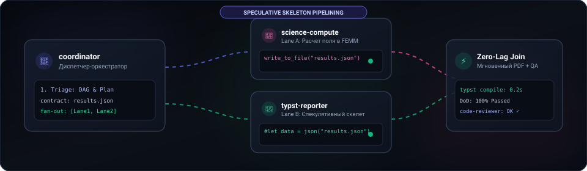
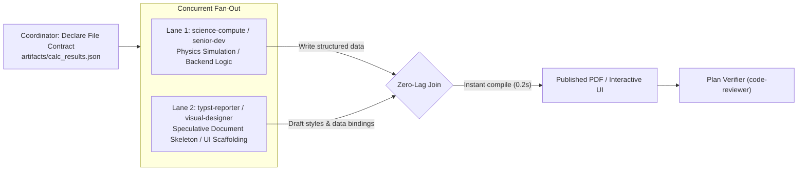

# ⚡ Antigravity Multi-Agent Ecosystem (v2.5)
### High-Velocity Engineering Squad, Speculative Skeleton Pipelining & "Think in Code" Token Economy for Google Antigravity

<div align="center">

[](showcase.html)

[](README.md)
[](README_RU.md)
[](https://antigravity.google)
[](https://github.com/SGBR22/antigravity-team)
[](https://github.com/SGBR22/antigravity-team)
[](https://github.com/SGBR22/antigravity-team)
[-FF6D00?style=flat-square)](https://github.com/SGBR22/antigravity-team)
[](LICENSE)

*An industrial-grade multi-agent engineering squad for Google Antigravity: CAD automation (Kompas-3D, Blender bpy), physical & mathematical modeling (COMSOL Multiphysics MPh, FEMM, GUM metrology), clean backend TDD, empirical autoresearch (Karpathy loop), modular system architecture (ECC), and publication-ready Typst reports.*

**English** • **[Русский](README_RU.md)** • **[Live Interactive Showcase (showcase.html)](showcase.html)**

[Quick Start](#-quick-start) • [Auto-Dispatch Matrix](#-mandatory-auto-dispatch) • [Speculative Skeleton Pipelining](#-speculative-skeleton-pipelining) • [Subagent Squad](#-specialized-subagents-10-roles) • [Active Token Shield](#-active-token-shield) • [Repository Structure](#-repository-structure)

</div>

---

## 🎨 Interactive Kokonut UI & Anime.js Showcase

An interactive, responsive dashboard styled with **Kokonut UI** dark-mode aesthetics and **Anime.js** physics animations is included directly in the repository:

👉 **[Launch Interactive Showcase (showcase.html)](showcase.html)**

<div align="center">



</div>

---

## 🚀 Quick Start

1. Clone the repository:
   ```bash
   git clone https://github.com/SGBR22/antigravity-team.git
   cd antigravity-team
   ```
2. Run the one-click installer:
   ```powershell
   powershell -ExecutionPolicy Bypass -File .\install-team.ps1
   ```
   *(Or right-click `install-team.ps1` $\to$ **"Run with PowerShell"**)*.
3. The script automatically installs the plugin into `~/.gemini/config/plugins/antigravity-team`, activates it in `config.json`, and offers to install engineering Python dependencies.
4. Restart Google Antigravity.

---

## 🚨 Mandatory Auto-Dispatch

Antigravity automatically routes each incoming task domain according to strict role isolation rules:

| Domain / Task | Auto-Dispatched Subagent | Strict Boundaries & Mandate |
| :--- | :--- | :--- |
| **Planning, DAG decomposition, contracts, ADR** | 🏛️ `system-architect` | **Master Planner**: designs dependency DAGs, interface contracts, and Definition of Done (DoD). |
| **Dispatching, concurrent lanes, pipelines** | 🎯 `coordinator` | **Execution Dispatcher**: launches parallel lanes and synchronizes contracts. *Forbidden from writing code or reports!* |
| **Backend code, algorithms, scripts, CLI, TDD** | ⚡ `senior-dev` | High-velocity systems engineer. *Strictly backend/logic — forbidden from writing UI/HTML/CSS!* |
| **Frontend, UI, HTML/CSS, Tailwind, dashboards** | 🎨 `visual-designer` | **Exclusive UI Authority**: builds web interfaces, interactive panels, Mermaid diagrams, and charts. |
| **Code audit, security, diff review, plan QA** | 🛡️ `code-reviewer` | **Plan Verifier & QA Auditor**: validates plan completion (DoD), edge cases, and resource leaks. |
| **Reports, notes, GOST 7.32, tech memos, PDF** | 📄 `typst-reporter` | **Exclusive Report Authority**: typesets all publication-grade documents via Typst using external `results.json`. |
| **COMSOL, MPh, HV bushings, FEMM, metrology** | 🧮 `science-compute` | Electrophysics & numerical modeling; exports matrices and metrics to `results.json`. |
| **Kompas-3D, Blender bpy, 3D printing (FDM/SLA)** | 📐 `cad-specialist` | CAD automation via pywin32 API 5/7, procedural 3D modeling, and slicing checks. |
| **Autonomous research, benchmarks, exploration** | 🔬 `researcher` | Karpathy & Hermes loop: hypothesis $\to$ probe script $\to$ factual findings. |
| **Web navigation, GOST/IEC standards, official APIs** | 🌐 `web-surfer` | Precision data synthesis without conversational fluff. |

---

## ⚡ Speculative Skeleton Pipelining

Eliminates sequential idle time: when a job involves both computation and documentation/UI, agents launch **concurrently**:



---

## 👥 Multi-Dev Consensus Loop (Collaborative Coding)

1. **Solution Discussion**: `senior-dev` formulates the architecture (types, boundary conditions) before large changes.
2. **Peer Review**: `code-reviewer` validates against regressions, COM/process leaks, and prepares test cases.
3. **TDD Loop**: Failing test (RED) $\to$ minimal clean code (GREEN) $\to$ headless `pytest -q`.
4. **Acceptance**: `code-reviewer` verifies code against the Definition of Done.

---

## 🛡️ Active Token Shield

1. **Direct-Answer Principle**: No polite preambles. Immediate deliverables, diffs, or commands.
2. **"Think in Code" Paradigm (Karpathy Standard)**:
   - Never ingest giant raw logs or CSVs into prompt context.
   - Run a 5-10 line headless probe script or PowerShell filter, emitting $< 15$ lines of summary.
3. **Differential Referencing**: Send clickable line pointers `[file.py](file:///path/to/file.py#L40-L65)` instead of pasting whole files.
4. **Dense TOON Notation**: Uses YAML/TOON for inter-agent messages, cutting 40–60% token overhead.
5. **Anti-Loop Circuit Breaker**: Halt immediately after 2 consecutive failures and switch hypotheses.

---

## 📂 Repository Structure

```
antigravity-team/
├── antigravity-team/              # Plugin core (installed to ~/.gemini/config/plugins/)
│   ├── agents/                   # 10 specialized subagents (.md)
│   ├── skills/                   # 14 skill directories (SKILL.md)
│   ├── rules/                    # Auto-Dispatch & Token rules (AGENTS.md)
│   └── plugin.json               # Plugin manifest
├── assets/                       # Graphics & animated SVG (pipeline-anim.svg)
├── showcase.html                 # Interactive Web Showcase (Kokonut UI + Anime.js)
├── AGENTS.md                     # Workspace auto-dispatch rules
├── install-team.ps1              # Automated installer
├── export-team.ps1               # Portable bundle packager
├── README.md                     # English documentation
├── README_RU.md                  # Russian documentation
├── SETUP_GUIDE.md                # English setup guide
└── SETUP_GUIDE_RU.md             # Russian setup guide
```
