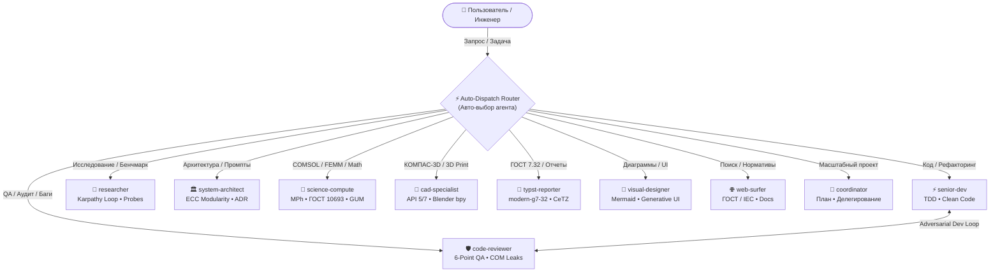

# ⚡ Antigravity Multi-Agent Ecosystem (v2.5)
### Высокопроизводительный инженерный сквад и токен-экономика «Think in Code» для Google Antigravity

<div align="center">

[](README.md)
[](README_RU.md)
[](https://antigravity.google)
[](https://github.com/SGBR22/antigravity-team)
[](https://github.com/SGBR22/antigravity-team)
[](https://github.com/SGBR22/antigravity-team)
[-FF6D00?style=flat-square)](https://github.com/SGBR22/antigravity-team)
[](LICENSE)

*Полноценный инженерно-программный комплекс субагентов для Google Antigravity: проектирование в САПР (КОМПАС-3D, Blender), физико-математическое моделирование (COMSOL Multiphysics MPh, FEMM, GUM), разработка по стандартам TDD, автономные эмпирические исследования (Karpathy Autoresearch), модульная системная архитектура (ECC) и публикационные отчеты по ГОСТ 7.32.*

**[English](README.md)** • **Русский**

[Быстрый старт](#-быстрый-старт-за-1-клик) • [Авто-выбор агентов (Auto-Dispatch)](#-автоматический-выбор-агентов-auto-dispatch) • [Команда субагентов](#-команда-субагентов-10-ролей) • [Матрица навыков](#-матрица-14-прогрессивных-навыков) • [Структура репозитория](#-структура-репозитория) • [Полное руководство (RU)](SETUP_GUIDE_RU.md)

</div>

---

## 🚀 Быстрый старт за 1 клик

1. Склонируйте репозиторий:
   ```bash
   git clone https://github.com/SGBR22/antigravity-team.git
   cd antigravity-team
   ```
2. Запустите скрипт установки:
   ```powershell
   powershell -ExecutionPolicy Bypass -File .\install-team.ps1
   ```
   *(Или нажмите правой кнопкой мыши на `install-team.ps1` $\to$ **«Выполнить с помощью PowerShell»**)*.
3. Скрипт автоматически скопирует плагин в `~/.gemini/config/plugins/antigravity-team`, активирует его в `config.json` и предложит установить инженерные Python-пакеты.
4. Перезапустите Google Antigravity.

---

## 🚨 Автоматический выбор агентов (Auto-Dispatch)

Система работает по жесткому правилу автоматической маршрутизации: вам не нужно вручную просить запустить агента. Antigravity автоматически делегирует подзадачу через `invoke_subagent`:

| Направление задачи | Вызываемый субагент | Ключевая механика |
| :--- | :--- | :--- |
| **Код, баги, рефакторинг, тесты** | ⚡ `senior-dev` | Написание чистого кода по циклу TDD без лишних типов. |
| **Аудит безопасности, поиск утечек памяти** | 🛡️ `code-reviewer` | Противнический 6-точечный QA-контроль. |
| **Исследования библиотек, бенчмарки** | 🔬 `researcher` | Цикл Karpathy & Hermes: гипотеза $\to$ скрипт $\to$ факты. |
| **Архитектура модулей, промпты, интерфейсы** | 🏛️ `system-architect` | Стандарт ECC (Everything Claude Code), ADR-записи. |
| **COMSOL, MPh, высоковольтные вводы, FEMM, погрешности** | 🧮 `science-compute` | Физико-математическое моделирование и метрология. |
| **КОМПАС-3D, Blender bpy, 3D-печать (FDM/SLA)** | 📐 `cad-specialist` | Автоматизация САПР pywin32 API 5/7, допуски. |
| **Отчеты по ГОСТ 7.32, Typst, схемы CeTZ** | 📄 `typst-reporter` | Публикационные документы по ГОСТ/ЕСКД. |
| **Диаграммы Mermaid, UI-виджеты, дашборды** | 🎨 `visual-designer` | Интерактивные интерфейсы и визуализация. |
| **Поиск в интернете, стандарты ГОСТ/IEC** | 🌐 `web-surfer` | Точечный сбор фактов без информационного шума. |
| **Комплексные междисциплинарные проекты** | 🎯 `coordinator` | Декомпозиция, Roadmaps, оркестровка. |

---

## 🧭 Архитектура экосистемы



---

## 👥 Команда субагентов (10 ролей)

1. 🎯 **`coordinator`** — Центральный оркестратор. Декомпозирует сложные проекты, формирует планы работ и управляет субагентами.
2. ⚡ **`senior-dev`** — Ведущий разработчик. Пишет чистый, надежный код по TDD без перегрузки типами.
3. 🛡️ **`code-reviewer`** — QA-аудитор. Проводит 6-точечную инспекцию кода на баги, логические дыры и утечки COM-ресурсов.
4. 🔬 **`researcher`** — Исследователь в стиле Andrej Karpathy и NousResearch Hermes. Быстро проверяет гипотезы с помощью headless-скриптов.
5. 🏛️ **`system-architect`** — Системный архитектор в стиле ECC. Контролирует границы модулей, контракты интерфейсов и гигиену контекста.
6. 🧮 **`science-compute`** — Физик-вычислитель. Автоматизирует COMSOL Multiphysics через MPh, FEMM, расчет высоковольтных вводов и погрешностей по ГОСТ 8.207.
7. 📐 **`cad-specialist`** — САПР-инженер. Автоматизирует КОМПАС-3D (pywin32 API 5/7, штампы ГОСТ 2.104), скриптует Blender (bpy) и готовит детали к 3D-печати.
8. 📄 **`typst-reporter`** — Технический писатель. Генерирует отчеты в Typst по ГОСТ 7.32 с векторными схемами CeTZ.
9. 🎨 **`visual-designer`** — Дизайнер интерфейсов. Создает диаграммы Mermaid, интерактивные панели Generative UI и дашборды.
10. 🌐 **`web-surfer`** — Веб-исследователь. Проводит точечный сбор информации, стандартов ГОСТ/IEC и официальной документации.

---

## 🛠️ Матрица 14 прогрессивных навыков (Skills)

1. `autoresearch` — Автономный цикл Karpathy & Hermes (гипотеза $\to$ скрипт $\to$ метрика $\to$ выжимка).
2. `system-architecture` — Стандарты модульной архитектуры и ADR-записи в стиле ECC.
3. `token-budget-optimizer` — Оптимизация контекста и защита от выгорания токенов.
4. `test-driven-development` — Практичный TDD для Python, JavaScript, Rust и C++.
5. `systematic-debugging` — Научная отладка по гипотезам с правилом останова «Halt-at-2».
6. `code-refactoring-and-architecture` — Clean Code, устранение дублирования и мертвого кода.
7. `git-workflow-and-commits` — Conventional Commits 1.0 и атомарные коммиты.
8. `hv-bushing-calc` — Электрофизический расчет вводов в COMSOL Multiphysics и FEMM.
9. `metrology-lab-data` — Статистическая обработка измерений по ГОСТ 8.207 (Стьюдент, МНК).
10. `uncertainty-and-units` — Учет размерностей и неопределенностей по стандарту GUM (`pint`, `uncertainties`).
11. `kompas-3d-automation` — Управление КОМПАС-3D через pywin32, заполнение штампа по ГОСТ 2.104.
12. `blender-bpy-modeling` — Headless Python-скриптинг Blender (`bpy`), экспорт STL/GLTF.
13. `three-d-printing-preflight` — Инженерный контроль 3D-печати (допуски, усадка PLA/PETG/ABS/PA-CF).
14. `typst-report` — Компиляция отчетов по ГОСТ 7.32 с векторной графикой CeTZ.

---

## 📂 Структура репозитория

```
antigravity-team/
├── antigravity-team/              # Ядро плагина (копируется в ~/.gemini/config/plugins/)
│   ├── agents/                   # 10 специализированных субагентов (.md)
│   ├── skills/                   # 14 директорий с навыками (SKILL.md)
│   ├── rules/                    # Правила Auto-Dispatch и токен-экономики (AGENTS.md)
│   └── plugin.json               # Манифест плагина
├── AGENTS.md                     # Правила автоматической маршрутизации для воркспейса
├── install-team.ps1              # Автоматический инсталлятор плагина в систему
├── README.md                     # Документация на английском языке
├── README_RU.md                  # Документация на русском языке
├── SETUP_GUIDE.md                # Руководство по настройке (English)
└── SETUP_GUIDE_RU.md             # Руководство по настройке (Русский)
```
