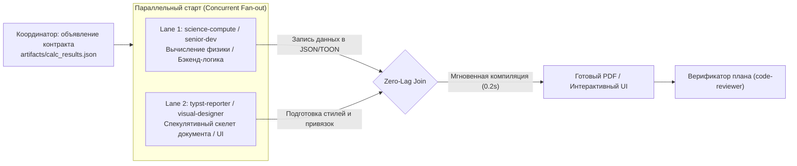

# ⚡ Antigravity Multi-Agent Ecosystem (v2.6)
### Высокопроизводительный инженерный сквад, параллельный конвейер, Craft UI и токен-экономика «Think in Code» для Google Antigravity

<div align="center">

[](showcase.html)

[](README.md)
[](README_RU.md)
[](https://antigravity.google)
[](https://github.com/SGBR22/antigravity-team)
[](https://github.com/SGBR22/antigravity-team)
[](https://github.com/SGBR22/antigravity-team)
[-FF6D00?style=flat-square)](https://github.com/SGBR22/antigravity-team)
[](LICENSE)

*Полноценный инженерно-программный комплекс субагентов для Google Antigravity: проектирование в САПР (КОМПАС-3D, Blender bpy), физико-математическое моделирование (COMSOL Multiphysics MPh, FEMM, GUM), бэкенд по стандартам TDD, автономные эмпирические исследования (Karpathy Autoresearch), современный адаптивный дизайн и витрины проектов без AI-клише (Craft UI), модульная архитектура (ECC) и публикационные отчеты по ГОСТ 7.32.*

**[English](README.md)** • **Русский** • **[Интерактивная панель (showcase.html)](showcase.html)**

[Быстрый старт](#-быстрый-старт-за-1-клик) • [Авто-выбор агентов (Auto-Dispatch)](#-автоматический-выбор-агентов-auto-dispatch) • [Параллельный конвейер](#-параллельный-конвейер-со-спекулятивными-скелетами) • [Команда субагентов](#-команда-субагентов-10-ролей) • [Active Token Shield](#-active-token-shield-экономия-лимитов) • [Структура репозитория](#-структура-репозитория)

</div>

---

## 🎨 Интерактивная визуализация (Kokonut UI + Anime.js)

В проект встроен интерактивный дашборд с эстетикой **Kokonut UI** и физическими анимациями на **Anime.js**, визуализирующий многопоточную работу агентов и симуляцию параллельного конвейера:

👉 **[Открыть интерактивное демо (showcase.html)](showcase.html)**

<div align="center">


</div>

---

## 🚀 Быстрый старт за 1 клик

1. Склонируйте репозиторий:
   ```bash
   git clone https://github.com/SGBR22/antigravity-team.git
   cd antigravity-team
   ```
2. Запустите скрипт установки:
   ```powershell
   powershell -ExecutionPolicy Bypass -File .\install-team.ps1
   ```
   *(Или нажмите правой кнопкой мыши на `install-team.ps1` $\to$ **«Выполнить с помощью PowerShell»**)*.
3. Скрипт автоматически скопирует плагин в `~/.gemini/config/plugins/antigravity-team`, активирует его в `config.json` и предложит установить инженерные Python-пакеты.
4. Перезапустите Google Antigravity.

---

## 🚨 Автоматический выбор агентов (Auto-Dispatch)

Система работает по жесткому регламенту ответственности. Вам не нужно вручную просить запустить агента — Antigravity автоматически делегирует подзадачу через `invoke_subagent`:

| Направление задачи / Триггеры | Вызываемый субагент | Строгие границы ответственности |
| :--- | :--- | :--- |
| **Планирование, декомпозиция графа, контракты, ADR** | 🏛️ `system-architect` | **Главный планировщик**: формирует DAG задач, интерфейсные контракты и критерии готовности (DoD). |
| **Диспетчеризация, запуск параллельных потоков, пайплайны** | 🎯 `coordinator` | **Диспетчер-оркестратор**: параллельный запуск агентов, синхронизация контрактов. *Запрещено писать код, верстать отчеты и дизайн!* |
| **Код бэкенда, алгоритмы, скрипты, CLI, TDD** | ⚡ `senior-dev` | Написание серверного и расчетного кода. *Запрещено писать фронтенд/HTML/CSS/дизайн! Обязательное парное ревью.* |
| **Визуальное оформление, дизайн проектов, UI/UX, веб-страницы, Tailwind/CSS, виджеты, дашборды, шоукейсы** | 🎨 `visual-designer` | **Единый центр дизайна и UI**: адаптивная современная эстетика без AI-клише (любые стили под контекст: Dev-tools, Swiss editorial, Industrial hardware, Refined humanist, SaaS), витрины проектов, UI/UX, дизайн-системы. |
| **Аудит кода, безопасность, ревью diff, верификация плана** | 🛡️ `code-reviewer` | **Верификатор плана и кода**: проверка соответствия плану, поиск краевых багов, утечек памяти и слабых тестов. |
| **Любые отчеты, ПЗ, ГОСТ 7.32, технические записки, PDF** | 📄 `typst-reporter` | **Единый центр отчетов**: верстка документов в Typst, публикационный PDF, связка с внешними `results.json`. |
| **COMSOL, MPh, высоковольтные вводы, FEMM, погрешности** | 🧮 `science-compute` | Физико-математические расчеты, выгрузка чисел и матриц в `results.json`. *Не верстает отчеты самостоятельно!* |
| **КОМПАС-3D, Blender bpy, штампы ГОСТ 2.104, 3D-печать** | 📐 `cad-specialist` | Автоматизация САПР pywin32 API 5/7, процедурное 3D-моделирование, допуски. |
| **Исследование репозиториев, бенчмарки, гипотезы** | 🔬 `researcher` | Автономный исследовательский цикл Karpathy: гипотеза $\to$ скрипт $\to$ результат. |
| **Поиск в интернете, стандарты ГОСТ/IEC, актуальные API** | 🌐 `web-surfer` | Целевой сбор проверенных веб-источников без мусора. |

---

## ⚡ Параллельный конвейер со спекулятивными скелетами

В системе исключены последовательные задержки, когда один агент простаивает в ожидании другого:



---

## 👥 Multi-Dev Consensus Loop (Коллаборативное программирование)

При любых задачах на написание кода:
1. **Обсуждение решения**: `senior-dev` перед внедрением формулирует архитектурное решение (входные/выходные типы, пограничные случаи).
2. **Парный контроль**: `code-reviewer` валидирует решение на предмет регрессий, утечек ресурсов (COM-объекты, дескрипторы) и формулирует тестовые сценарии.
3. **TDD-цикл**: Падающий тест (RED) $\to$ минимальный код (GREEN) $\to$ headless-прогон `pytest -q`.
4. **Приемка**: `code-reviewer` сверяет код с критериями готовности перед подтверждением.

---

## 🛡️ Active Token Shield (Экономия лимитов без потери точности)

1. **Direct-Answer Principle**: Никаких вежливых вступлений и преамбул. Сразу результат, план, diff или команда.
2. **The "Think in Code" Paradigm (Стандарт Karpathy)**:
   - Запрещено читать гигантские логи и файлы целиком.
   - Для анализа данных пишется одноразовый скрипт (5–10 строк) через `run_command`, выводящий компактную сводку ($< 15$ строк).
3. **Дифференциальные ссылки**: Передача кликабельных ссылок с диапазоном строк `[file.py](file:///path/to/file.py#L40-L65)` вместо цитирования полных файлов.
4. **Компактная нотация TOON**: Вместо громоздкого JSON используется плотная YAML/TOON-структура.
5. **Anti-Loop Circuit Breaker ("Стоп на 2")**: При повторе ошибки 2 раза подряд немедленный останов и смена тактики.

---

## 📂 Структура репозитория

```
antigravity-team/
├── antigravity-team/              # Ядро плагина (копируется в ~/.gemini/config/plugins/)
│   ├── agents/                   # 10 специализированных субагентов (.md)
│   ├── skills/                   # 15 директорий с навыками (SKILL.md, включая craft-ui-engineering)
│   ├── rules/                    # Правила маршрутизации и токен-экономики (AGENTS.md)
│   └── plugin.json               # Манифест плагина
├── assets/                       # Графика и анимированные SVG (pipeline-anim.svg)
├── showcase.html                 # Интерактивная веб-витрина (Kokonut UI + Anime.js)
├── AGENTS.md                     # Правила автоматической маршрутизации для воркспейса
├── install-team.ps1              # Автоматический инсталлятор плагина в систему
├── export-team.ps1               # Скрипт пересборки ZIP-дистрибутива
├── README.md                     # Документация на английском языке
├── README_RU.md                  # Документация на русском языке
├── SETUP_GUIDE.md                # Руководство по настройке (English)
└── SETUP_GUIDE_RU.md             # Руководство по настройке (Русский)
```
