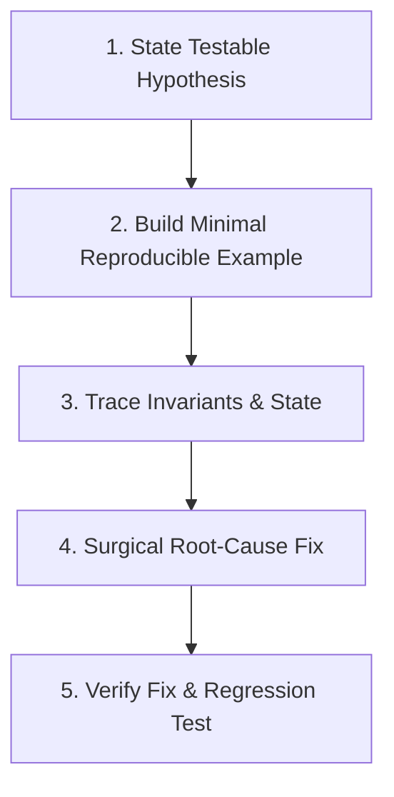

# Systematic Debugging Protocol

This skill enforces a scientific, evidence-based approach to finding and fixing software bugs. It strictly prohibits **"shotgun debugging"** (making random, speculative changes hoping the bug disappears).

---

## 1. The 5-Step Scientific Debugging Method



### Step 1: Formulate a Testable Hypothesis
- Before touching code, write down a single clear sentence:
  > *"I hypothesize that the function crashes with `IndexError` on line 42 because `items` is empty when the user has no active sessions."*
- Reject vague statements like *"Maybe something is wrong with async"* or *"Let's try wrapping it in try/except"*.

### Step 2: Isolate a Minimal Reproducible Example (MRE)
- Extract the smallest possible snippet or test case that reproduces the defect in under 10 lines of code.
- Execute it headlessly via `run_command`.

### Step 3: Trace Invariants and State
- Verify what actual data is passed into the failing point.
- Use headless assertions or a 1-line script to inspect values:
  ```python
  assert isinstance(data, dict), f"Expected dict, got {type(data)}: {data}"
  ```
- Identify exactly which invariant or assumption was violated.

### Step 4: Surgical Root-Cause Fix
- Fix the **root cause**, not the superficial symptom:
  - Do NOT just silence exceptions with `except Exception: pass`.
  - Fix the underlying state mutation, boundary check, or logic gap.
- Use `replace_file_content` to make a minimal, atomic diff.

### Step 5: Regression Verification
- Run the test suite to confirm the MRE now passes and no existing tests broke.

---

## 2. Anti-Loop Circuit Breaker ("Halt-at-2 Rule")

To protect token budget and avoid endless debugging loops:
1. **Attempt 1**: Formulate hypothesis $\to$ make fix $\to$ run test.
2. **Attempt 2**: If the bug persists or a new diagnostic appears, formulate an adjusted hypothesis $\to$ make second fix $\to$ run test.
3. **If Attempt 2 Fails**: **STOP IMMEDIATELY**.
   - Do NOT run a 3rd speculative edit.
   - Output an explicit diagnostic report:
     - **Known Working State**: What parts pass.
     - **Known Failing State**: The exact error message and failing assertion.
     - **Root Cause Hypothesis**: What underlying mechanism or external dependency is behaving unexpectedly.
     - **Escalation / Alternative Strategy**: Alternative architectural fix or question for the user.
