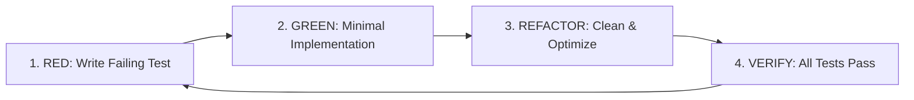

# Test-Driven Development (TDD) Protocol

This skill guides software development using the rigorous **Red-Green-Refactor** cycle to guarantee zero defects, high test coverage, and regression prevention.

---

## 1. The Core TDD Cycle (Red-Green-Refactor)



### Phase 1: RED (Write the Test First)
- Never write production code before having an automated test that fails for the expected reason.
- Define the contract, inputs, expected outputs, and error handling upfront.
- Run the test suite via `run_command` in headless mode to **verify that it fails** with an expected assertion or `NotImplementedError`.

### Phase 2: GREEN (Make it Pass)
- Write the *minimal amount of code* necessary to pass the failing test.
- Do not over-engineer or add speculative functionality ("YAGNI" — You Aren't Gonna Need It).
- Run the test suite to confirm all tests pass.

### Phase 3: REFACTOR (Make it Right)
- Eliminate duplicate code, clarify variable and function naming, reduce complexity.
- Ensure strict static typing (`mypy --strict`, TypeScript strict, modern C++ types).
- Re-run test suite to ensure no regressions were introduced.

---

## 2. Headless Test Execution Standards ("Think in Code")

To save context tokens and avoid verbose terminal outputs, always execute test runners in quiet/concise mode:

| Language / Framework | Recommended Command | Token Saving Flag |
|---|---|---|
| **Python (`pytest`)** | `pytest -q --tb=short` | `-q` (quiet), `--tb=short` (minimal traceback) |
| **Python (`unittest`)**| `python -m unittest discover -v` | Filter to single test file or class when possible |
| **Node / TS (`vitest`)**| `npx vitest run --reporter=basic` | Non-interactive single run |
| **Node / TS (`jest`)**  | `npx jest --silent --runInBand` | Silent logs, single runner |
| **Rust (`cargo`)**     | `cargo test -- --nocapture` (or `-q`) | Filter to specific test: `cargo test <test_name>` |
| **C / C++ (`ctest`)**  | `ctest --output-on-failure` | Prints details only for failed tests |

---

## 3. Boundary & Negative Testing Checklist

Every unit under test must cover:
1. **Happy Path**: Standard expected inputs with expected outputs.
2. **Boundary Values**: Empty arrays, 0, negative values, max integer, boundary indices ($0, N-1, N$).
3. **Invalid Inputs**: `None` / `null`, unexpected types, malformed strings.
4. **Exception Verification**: Ensure specific expected exceptions (`ValueError`, `KeyError`, `TimeoutError`) are raised.

### Python Example:
```python
import pytest

def test_divide_happy_path():
    assert divide(10, 2) == 5.0

def test_divide_by_zero():
    with pytest.raises(ZeroDivisionError):
        divide(10, 0)

@pytest.mark.parametrize("a,b,expected", [
    (0, 5, 0.0),
    (-10, 2, -5.0),
    (1e12, 1e6, 1e6),
])
def test_divide_edge_cases(a, b, expected):
    assert divide(a, b) == pytest.approx(expected)
```
